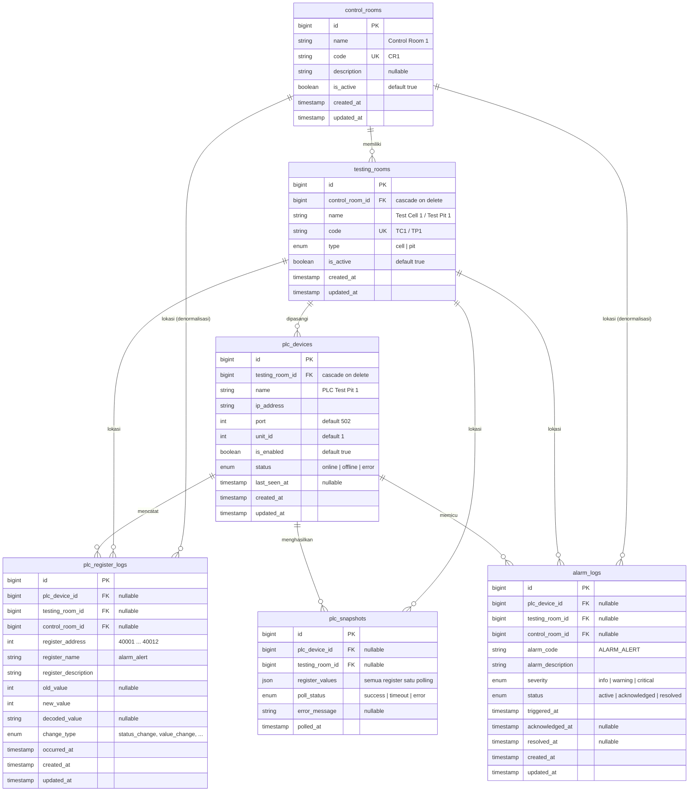
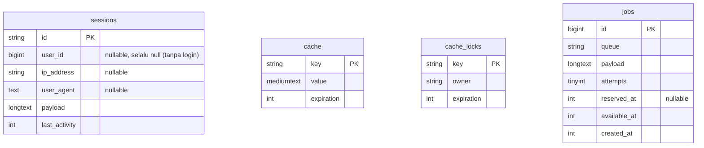

# ERD — Testing Bay Monitoring

Diagram relasi entitas (ERD) database **SQL Server** aplikasi Testing Bay, disusun dari file migrasi di `database/migrations/` dan relasi Eloquent di `app/Models/`. Bagian akhir berisi **rekomendasi penamaan**; skema dan kode belum diubah.

---

## 1. ERD tabel inti (operasional)

### Kardinalitas

| Relasi | Jenis | Catatan |
| --- | --- | --- |
| `control_rooms` → `testing_rooms` | 1 : N | Hapus control room ikut menghapus testing room-nya (cascade) |
| `testing_rooms` → `plc_devices` | 1 : N (praktiknya 1 : 1) | Seeder membuat tepat 1 PLC per ruang, tapi skema tidak memaksa (tidak ada unique) |
| `plc_devices` → `plc_register_logs` / `plc_snapshots` / `alarm_logs` | 1 : N | FK nullable, `no action` saat dihapus |
| `testing_rooms` → log, snapshot, alarm | 1 : N | FK nullable |
| `control_rooms` → `plc_register_logs` / `alarm_logs` | 1 : N | Denormalisasi: bisa diturunkan dari `testing_rooms.control_room_id`, disimpan untuk query cepat |

### Data hasil seeder

| Tabel | Jumlah | Isi |
| --- | --- | --- |
| `control_rooms` | 3 | CR1 (Cell 1–3), CR2 (Cell 4–5, Pit 1–2), CR3 (Pit 3–6) |
| `testing_rooms` | 11 | 5 test cell + 6 test pit |
| `plc_devices` | 11 | Satu per testing room |

---

## 2. Data yang tidak disimpan di tabel

| Data | Lokasi | Keterangan |
| --- | --- | --- |
| Snapshot PLC terbaru per ruang | Cache `plc_snapshot_{testing_room_id}` | Ditulis webhook, dibaca `/api/dashboard` dan `/api/plc/{id}/data` |
| Label register PLC | `config/plc_registers.php` | Nama & deskripsi register untuk log |
| Peta register Modbus | `python-modbus/modbus/register_map.py` | Alamat 40001–40012 → key + tipe |

---

## 3. Tabel pendukung Laravel (tanpa relasi ke tabel inti)

`sessions.user_id` tidak punya tabel `users` sebagai pasangan. Kolom ini tetap diperlukan karena handler session database Laravel selalu menulisnya.

---

## 4. Rekomendasi penamaan (belum diterapkan)

Daftar ini untuk keputusan berikutnya. Semua perubahan skema di bawah membutuhkan migrasi baru dan penyesuaian kode.

### 4.1 Tabel & kolom

| Saat ini | Usulan | Alasan |
| --- | --- | --- |
| `testing_rooms`, `testing_room_id`, model `TestingRoom` | `test_rooms`, `test_room_id`, `TestRoom` | Domain memakai istilah "Test Cell / Test Pit"; filter API sudah memakai `test_cell_id` |
| Filter API `test_cell_id` (alarm, activity log) | `test_room_id` | Filter juga berlaku untuk test pit, bukan hanya test cell |
| `alarm_logs.alarm_code`, `alarm_logs.alarm_description` | `code`, `description` | Prefix `alarm_` berulang dengan nama tabel |
| `plc_snapshots.register_values` | `registers` | Lebih ringkas, sama dengan istilah payload webhook (`snapshot`) |
| `plc_register_logs.change_type` = `door_locked` untuk kunci **dan** buka | Tambah `door_unlocked` | Nilai saat ini menyesatkan ketika pintu dibuka |

### 4.2 Kode & struktur file

| Saat ini | Usulan | Alasan |
| --- | --- | --- |
| `ActivityLogController` (Web & Api), `ActivityLogService` | `PlcRegisterLogController`, `PlcRegisterLogService` | Isinya log register PLC, sesuai menu "PLC register log" |
| `resources/views/admin/…`, `resources/views/operator/…` | `resources/views/settings/…` | Peran admin/operator sudah tidak ada |
| `resources/js/services/authService.js` | `apiClient.js` | Tidak ada autentikasi lagi; isinya helper `fetch` |
| `api_room_id` (JS) | `db_id` atau `test_room_id` | `id` di frontend berupa `cell1`/`pit1`; nama ini menjelaskan bahwa nilainya ID database |

### 4.3 Key register PLC (campuran bahasa)

| Address | Saat ini | Usulan |
| --- | --- | --- |
| 40001 | `tekanan_masuk` | `inlet_pressure` |
| 40004 | `roof_tertutup` | `roof_closed` |
| 40005 | `roof_terbuka` | `roof_open` |
| 40006 | `roof_bergerak_buka` | `roof_opening` |
| 40007 | `roof_bergerak_tutup` | `roof_closing` |
| 40008 | `pintu_terkunci` | `door_locked` |
| 40009 | `testing_dimulai` | `test_running` |

Key ini dipakai bersama oleh `python-modbus`, `config/plc_registers.php`, dan `resources/js/dashboard/main.js`, dan tersimpan di `plc_register_logs.register_name` serta `plc_snapshots.register_values`. Jika diganti, data log lama tetap memakai key lama.

### 4.4 Relasi Eloquent yang belum ada

Tidak mengubah skema, aman ditambahkan kapan saja:

- `TestingRoom::plcRegisterLogs()` — hasMany `PlcRegisterLog`.
- `ControlRoom::alarmLogs()` dan `ControlRoom::plcRegisterLogs()` — hasMany.
- Opsional: ganti `TestingRoom::plcDevices()` menjadi `hasOne` (`plcDevice()`) dan tambahkan unique index pada `plc_devices.testing_room_id` jika memang selalu 1 PLC per ruang.
