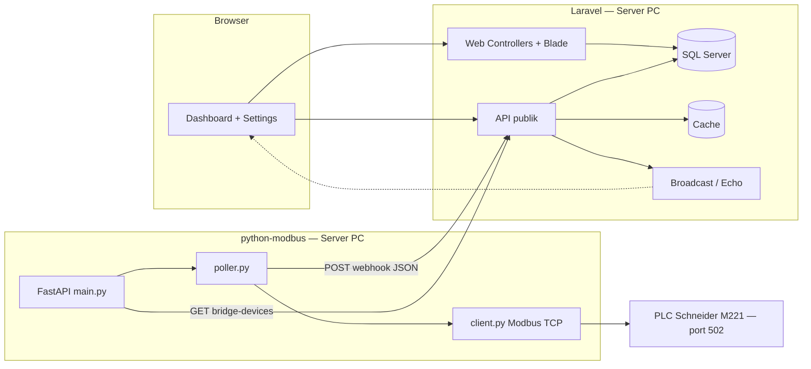

# Penjelasan Cara Kerja Sistem Testing Bay (tampilan & internals)

Dokumen ini menjelaskan **alur dari awal sampai akhir** dalam dua sudut pandang:

1. **Sisi luar (website / pengguna)** — apa yang dilihat dan dilakukan operator.
2. **Sisi dalam (kode & sintaks)** — file, endpoint, dan rantai eksekusi utama.

---

## 1. Gambaran arsitektur

- **Parameter PLC** disimpan di tabel **`plc_devices`** (Settings → PLC configuration).
- **python-modbus** memuat PLC enabled lewat **`GET /api/plc/bridge-devices`**; fallback `config.py`.
- Aplikasi **tanpa login**: semua rute web dan API terbuka. Hanya endpoint bridge (`webhook`, `bridge-devices`) yang dilindungi token/secret statis.

---

## 2. Sisi luar: alur pengguna (start → finish)

### 2.1 Masuk ke sistem

1. Pengguna membuka URL aplikasi (mis. `http://127.0.0.1:8000` atau IP server).
2. Dashboard (`/`) langsung tampil — tidak ada halaman login.

### 2.2 Dashboard (tampilan utama)

1. Rute **`/`** memuat halaman dashboard (Blade + aset Vite).
2. JavaScript memuat data agregat ruang lewat **`GET /api/dashboard`**.

**Perilaku UI utama:**

- Pengguna memilih **control room** di sidebar lalu **testing room** (pit/cell), atau mengklik gedung di peta 3D.
- Panel kanan menampilkan tekanan, posisi atap, status operasi, alarm ruangan, dan log peristiwa.
- Jika `VITE_PUSHER_APP_KEY` (dan konfigurasi Echo) aktif, frontend berlangganan channel **`plc.room.{roomId}`** → event **`.PlcRoomUpdated`** memperbarui data real-time tanpa reload.

**File terkait (frontend):**

- `resources/views/shared/dashboard.blade.php` — kerangka HTML.
- `resources/js/dashboard/main.js` — sidebar, panel ruang, alarm gabungan, polling, `bindPlcEchoForRoom`.
- `resources/js/dashboard/demoRoofControls.js` — panel Demo roof (dummy mode).
- `resources/js/dashboard/init.js` — urutan inisialisasi UI + Three.js.
- `resources/js/services/dashboardData.js` — `getDashboardData()`, `PlcAPI.getRoomData`.
- `resources/js/services/authService.js` — helper `fetch` JSON ke API (tanpa token).

### 2.3 Settings — PLC

**PLC configuration (`/settings/plc`):**

1. Kartu per device: IP, port, unit ID, enable polling.
2. **PUT** ke Laravel → tabel **`plc_devices`**.
3. python-modbus memuat ulang daftar device ~15 detik jika `LARAVEL_BRIDGE_DEVICES_URL` diisi.

**PLC register log (`/settings/plc-log`):** tabel riwayat perubahan register dari `plc_register_logs`.

**File terkait:**

- `app/Http/Controllers/Web/PlcConnectionController.php`
- `app/Http/Controllers/Web/ActivityLogController.php`
- `resources/views/operator/plc-connection.blade.php`
- `resources/views/admin/activity-logs/index.blade.php`

### 2.4 Mode dummy

- `VITE_DASHBOARD_USE_DUMMY=true` → data statis dari `resources/js/data/dummy.js`, kontrol simulasi di panel ruang (tekanan, mode, pintu, emergency, trigger alarm), dan panel **Demo roof** di peta 3D.

---

## 3. Sisi dalam: rantai data PLC (start → finish)

### 3.1 Konfigurasi device di database

- Model **`App\Models\PlcDevice`** merepresentasikan satu PLC per **`testing_room_id`**.
- Field penting: `ip_address`, `port`, `unit_id`, `is_enabled`, `status`, `last_seen_at`.
- PLC Schneider M221 TM221CE24R: port 502, unit_id 1.

### 3.2 Startup bridge Python

1. **`python-modbus/main.py`** memuat **`.env`** dari folder `python-modbus`.
2. Jika **`ENABLE_POLLING`** aktif, pada lifespan FastAPI:
    - **`load_plc_devices_sync()`** (`modbus/device_loader.py`): HTTP GET ke Laravel → JSON `{ ok, devices: { "1": { ip, port, unit_id, name }, ... } }` hanya untuk `is_enabled=true`.
    - Fallback ke `config.PLC_DEVICES` jika URL kosong atau gagal.
    - **`start_polling()`** memulai loop async.

### 3.3 Polling Modbus

1. **`poll_all()`** memanggil **`poll_single(room_id)`** untuk setiap PLC secara paralel.
2. **`read_plc_registers`** (`modbus/client.py`):
    - Membuka `AsyncModbusTcpClient` ke `plc_config["ip"]` dan port 502.
    - Membaca **holding registers** mulai **PDU address 0** sebanyak **14 word** (`REGISTER_COUNT=14`) dengan unit_id=1.
    - Memetakan ke alamat logis **40001–40012** lewat **`REGISTER_MAP`** di `modbus/register_map.py`.
3. Hasil per ruang: status `success` / `timeout` / `error`, plus `data` berisi nilai ter-decode per register.

### 3.4 Register Map (ringkasan)

| Address | PDU   | Nama                  | Tipe    | Keterangan                                    |
| ------- | ----- | --------------------- | ------- | --------------------------------------------- |
| 40001   | 0     | `tekanan_masuk`       | uint16  | Tekanan masuk sebelum testing                 |
| 40002   | 1     | `alarm_alert`         | bool    | Alarm darurat / emergency                     |
| 40003   | 2     | `mode_maintenance`    | bool    | Panel dalam mode maintenance                  |
| 40004   | 3     | `roof_tertutup`       | bool    | Atap tertutup                                 |
| 40005   | 4     | `roof_terbuka`        | bool    | Atap terbuka                                  |
| 40006   | 5     | `roof_bergerak_buka`  | bool    | Atap bergerak membuka                         |
| 40007   | 6     | `roof_bergerak_tutup` | bool    | Atap bergerak menutup                         |
| 40008   | 7     | `pintu_terkunci`      | bool    | Pintu akses terkunci                          |
| 40009   | 8     | `testing_dimulai`     | bool    | Pengujian berjalan                            |
| 40010   | 9     | —                     | —       | Tidak dipakai (dibaca agar offset float benar) |
| 40011   | 10–11 | `pressure_1`          | float32 | Tekanan 1 (2 word)                            |
| 40012   | 12–13 | `pressure_2`          | float32 | Tekanan 2 (2 word)                            |

Total: **14 word** (PDU 0–13).

### 3.5 Deteksi perubahan dan webhook

1. **`detect_changes`** (`poller.py`) membandingkan snapshot register dengan state sebelumnya.
2. **`send_to_laravel`** mengirim **POST** ke **`LARAVEL_WEBHOOK_URL`** dengan JSON:
    - `room_id`, `polled_at`, `status`, `snapshot`, `changes`, `error`.
3. Header **`X-PLC-Secret`** ikut dikirim jika `PLC_WEBHOOK_SECRET` diisi.

### 3.6 Pemrosesan webhook di Laravel

**Rute:** `POST /api/plc/webhook` — **`App\Http\Controllers\Api\PlcController::webhook`**

Urutan logika:

1. Validasi opsional `X-PLC-Secret`.
2. Validasi payload (`room_id`, `changes`, `snapshot`, `status`, `polled_at`).
3. Cari `TestingRoom` dan `PlcDevice` untuk `room_id`.
4. Update `plc_devices`: `status`, `last_seen_at`.
5. Tulis **cache** `plc_snapshot_{roomId}`.
6. **Broadcast** event `PlcRoomUpdated` (channel `plc.room.{id}`).
7. Simpan baris `plc_snapshots`.
8. Untuk setiap item di `changes`, simpan `plc_register_logs`.
9. Khusus **register 40002** (`alarm_alert`): buat/resolve `AlarmLog` dengan kode `ALARM_ALERT`.

### 3.7 API yang tersedia

| Metode | Path                                     | Fungsi                                      |
| ------ | ---------------------------------------- | ------------------------------------------- |
| GET    | `/api/dashboard`                         | Payload dashboard semua control room aktif  |
| GET    | `/api/rooms`, `/api/rooms/{room_id}`     | Daftar / detail ruang uji                   |
| GET    | `/api/plc/all/data`                      | Snapshot cache semua ruang                  |
| GET    | `/api/plc/{room_id}/data`                | Snapshot cache terakhir untuk satu ruang    |
| GET    | `/api/plc/{room_id}/logs`                | Riwayat perubahan register                  |
| GET    | `/api/alarms`, `/api/alarms/count`       | Daftar alarm / jumlah alarm aktif           |
| PATCH  | `/api/alarms/{id}/ack`, `/resolve`       | Acknowledge / resolve alarm                 |
| GET    | `/api/activity-logs` (+ `/room`, `/maintenance`) | Log register PLC                    |
| GET    | `/api/plc/bridge-devices?token=...`      | Daftar PLC untuk python-modbus              |
| POST   | `/api/plc/webhook`                       | Masukan polling dari python-modbus          |

---

## 4. File dan direktori rujukan cepat

| Area                     | Lokasi                                             |
| ------------------------ | -------------------------------------------------- |
| Rute web                 | `routes/web.php`                                   |
| Rute API                 | `routes/api.php`                                   |
| Webhook & bridge         | `app/Http/Controllers/Api/PlcController.php`       |
| Dashboard API            | `app/Http/Controllers/Api/DashboardController.php` |
| Agregasi dashboard       | `app/Services/PlcDataService.php`                  |
| Event realtime           | `app/Events/PlcRoomUpdated.php`                    |
| Model PLC                | `app/Models/PlcDevice.php`                         |
| Seed data                | `database/seeders/DatabaseSeeder.php`              |
| Entry FastAPI            | `python-modbus/main.py`                            |
| Load device dari Laravel | `python-modbus/modbus/device_loader.py`            |
| Loop polling             | `python-modbus/modbus/poller.py`                   |
| Client Modbus            | `python-modbus/modbus/client.py`                   |
| Map register             | `python-modbus/modbus/register_map.py`             |
| Dashboard JS             | `resources/js/dashboard/main.js`                   |
| Echo / Pusher            | `resources/js/bootstrap.js`                        |

---

## 5. Alur waktu (ringkas)

1. **Operator** membuka dashboard → (opsional) ubah PLC di Settings → simpan ke DB.
2. **python-modbus** (PC server) membaca daftar device → polling **Modbus TCP** periodik (default tiap 1 detik).
3. Setiap siklus: baca 14 register → bandingkan dengan state → **POST webhook**.
4. **Laravel** validasi → update DB + cache → **broadcast** (jika dikonfigurasi).
5. **Browser** menerima via Echo, atau lewat polling `/api/dashboard` dan `/api/plc/{id}/data` (tiap 3–4 detik; 12–25 detik jika realtime aktif).

---

Untuk gambaran produk: **`docs/GAMBARAN_SISTEM.md`**. Untuk instalasi: **`docs/PANDUAN_MENJALANKAN_SISTEM.md`**.
