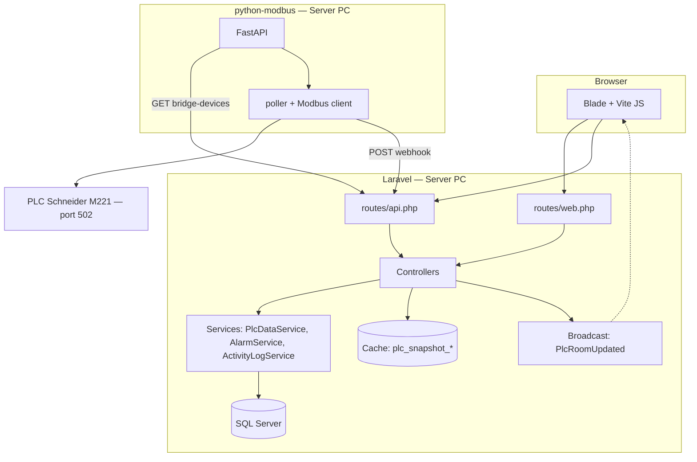
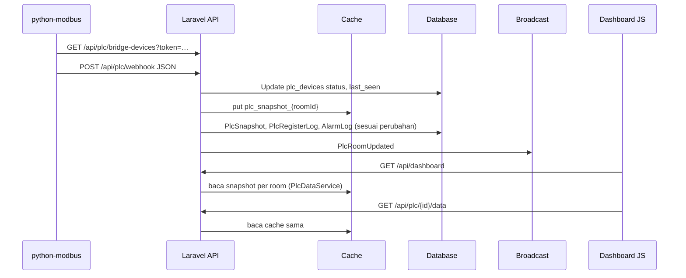
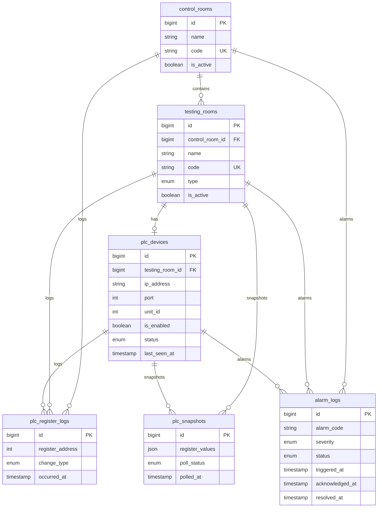

# Testing Bay Dashboard — Cara Kerja & Indeks File

Dokumen ini menjelaskan **cara kerja internal** (bukan hanya tampilan): pemuatan dashboard, pemanggilan API, data PLC, serta **indeks file** di repositori agar perubahan fitur bisa **dicek silang** (cari rute → controller → service/model → view/JS).

**Cakupan:** aplikasi Laravel di root repositori, aset `resources/`, migrasi `database/`, dan service `python-modbus/`. Folder `vendor/`, `node_modules/`, build Vite di `public/build` adalah dependensi/build artefak — tidak diuraikan per file.

---

## 1. Gambaran arsitektur

---

## 2. Akses: single-user tanpa login

- Tidak ada tabel `users`, halaman login, middleware `auth`/`role`, maupun token API.
- Semua rute web (`routes/web.php`) dan API (`routes/api.php`) terbuka untuk siapa pun di jaringan.
- Endpoint bridge untuk Python tetap dilindungi:
    - `GET /api/plc/bridge-devices?token=…` — dicocokkan dengan `PLC_BRIDGE_TOKEN`.
    - `POST /api/plc/webhook` — header `X-PLC-Secret` dicocokkan dengan `PLC_WEBHOOK_SECRET` (jika diisi).
- Session tetap dipakai untuk flash message ("Saved", dll.). Dengan `SESSION_DRIVER=database`, tabel `sessions` wajib memiliki kolom `user_id` (nullable), karena handler session Laravel selalu menulis kolom itu.

---

## 3. Isi sistem (dashboard & data)

### 3.1 Muat halaman utama

1. `GET /` memuat Blade dashboard + Vite entry `resources/js/app.js`.
2. `app.js` memanggil `initDashboard()` dari `resources/js/dashboard/init.js`.
3. `getDashboardData()` (`resources/js/services/dashboardData.js`) memanggil `GET /api/dashboard` (kecuali mode dummy → data dari `resources/js/data/dummy.js`).
4. **Backend:** `routes/api.php` → `Api\DashboardController` → `PlcDataService::buildDashboardPayload()`.
5. `PlcDataService` membaca `ControlRoom` / `TestingRoom` / `PlcDevice`, cache `plc_snapshot_{id}`, `AlarmLog`, log register → JSON `controlRooms + utilities` untuk semua control room aktif.

### 3.2 Loop "hidup" di browser

`Main.startLiveLoop()` menjalankan interval (`pollIntervalGlobalMs()`):
- Memanggil `getDashboardData()` → menyegarkan sidebar alarm, utilitas.
- Jika panel ruang terbuka: `GET /api/plc/{room_id}/data` → `applySnapshotToRoom`.

### 3.3 Peta 3D & interaksi

- `resources/js/three/scene.js` — adegan Three.js; klik gedung memanggil `openPanel` / `openRoomPanel`.
- `resources/js/dashboard/state.js` — `store`, `ui`, pemetaan `ROOM_TO_CR`.
- ID ruang dari API (`cell1`–`cell5`, `pit1`–`pit6`) harus sama dengan ID gedung di `scene.js`.

### 3.4 Realtime (opsional)

Jika Echo + Pusher/Reverb dikonfigurasi, `bindPlcEchoForRoom` di `main.js` mendengarkan `plc.room.{roomId}` → event `PlcRoomUpdated` dari `App\Events\PlcRoomUpdated`.

### 3.5 Mode dummy

`VITE_DASHBOARD_USE_DUMMY=true`:
- Data statis dari `resources/js/data/dummy.js`.
- Kontrol simulasi di panel ruang (tekanan, mode panel, status uji, pintu, emergency, status PLC, trigger alarm) — di `main.js`.
- Panel **Demo roof** (`demoRoofControls.js`) di peta 3D.

### 3.6 File terlibat (inti dashboard)

| File                                               | Peran                                         |
| -------------------------------------------------- | --------------------------------------------- |
| `routes/web.php`                                   | `GET /`, `settings/plc`, `settings/plc-log`   |
| `routes/api.php`                                   | Dashboard, ruang, PLC, alarm, log, bridge     |
| `app/Http/Controllers/Web/DashboardController.php` | Mengembalikan view dashboard                  |
| `app/Http/Controllers/Api/DashboardController.php` | JSON dashboard                                |
| `app/Services/PlcDataService.php`                  | Agregasi payload ruang + PLC + alarm          |
| `resources/js/app.js`                              | Entry + `initDashboard`                       |
| `resources/js/dashboard/init.js`                   | Urutan init UI + Three                        |
| `resources/js/dashboard/main.js`                   | Sidebar, panel, alarm, polling, Echo, demo    |
| `resources/js/dashboard/demoRoofControls.js`       | Panel Demo roof (dummy mode)                  |
| `resources/js/dashboard/state.js`                  | State global UI                               |
| `resources/js/services/dashboardData.js`           | `getDashboardData`, `PlcAPI.getRoomData`      |
| `resources/js/three/scene.js`                      | Visualisasi 3D                                |
| `resources/css/dashboard.css`                      | Gaya dashboard & settings                     |

---

## 4. Alur data PLC (ringkas sistemik)

**File utama:** `app/Http/Controllers/Api/PlcController.php`, `app/Services/PlcDataService.php`, `app/Events/PlcRoomUpdated.php`, `python-modbus/main.py`, `python-modbus/modbus/poller.py`, `python-modbus/modbus/device_loader.py`, `python-modbus/modbus/register_map.py`, `python-modbus/modbus/client.py`.

Alarm yang dibuat otomatis dari webhook: register **40002** (`alarm_alert`) → `AlarmLog` kode `ALARM_ALERT`.

---

## 5. ERD data (inti operasional)

Versi lengkap dengan semua kolom, kardinalitas, dan rekomendasi penamaan: [`ERD.md`](ERD.md).

Tabel pendukung Laravel: `sessions`, `cache`, `cache_locks`, `jobs`, `job_batches`, `failed_jobs`, `migrations`.

---

## 6. Indeks file aplikasi (`app/`)

| Path                                                 | Peran                                           |
| ---------------------------------------------------- | ----------------------------------------------- |
| `Providers/AppServiceProvider.php`                   | Binding singleton service                       |
| `Events/PlcRoomUpdated.php`                          | Event broadcast setelah webhook                 |
| `Models/ControlRoom.php`                             | Ruang kontrol                                   |
| `Models/TestingRoom.php`                             | Ruang uji pit/cell                              |
| `Models/PlcDevice.php`                               | Satu PLC per ruang uji                          |
| `Models/AlarmLog.php`                                | Catatan alarm                                   |
| `Models/PlcRegisterLog.php`                          | Log perubahan register                          |
| `Models/PlcSnapshot.php`                             | Riwayat snapshot (persisten)                    |
| `Services/PlcDataService.php`                        | Bentuk payload dashboard & normalisasi data PLC |
| `Services/AlarmService.php`                          | Query alarm (paginate, hitung aktif)            |
| `Services/ActivityLogService.php`                    | Query log register                              |
| `Http/Controllers/Controller.php`                    | Base controller                                 |
| `Http/Controllers/Web/DashboardController.php`       | Halaman `/`                                     |
| `Http/Controllers/Web/PlcConnectionController.php`   | Halaman & update settings PLC                   |
| `Http/Controllers/Web/ActivityLogController.php`     | Halaman PLC register log                        |
| `Http/Controllers/Api/DashboardController.php`       | `GET /api/dashboard`                            |
| `Http/Controllers/Api/RoomController.php`            | Daftar/detail ruang API                         |
| `Http/Controllers/Api/PlcController.php`             | Webhook, bridge, data, log PLC                  |
| `Http/Controllers/Api/AlarmController.php`           | Daftar alarm, ack, resolve                      |
| `Http/Controllers/Api/ActivityLogController.php`     | Log register API                                |

---

## 7. Rute & konfigurasi

| File                      | Isi                                                                 |
| ------------------------- | ------------------------------------------------------------------- |
| `routes/web.php`          | Dashboard, settings PLC, PLC register log                           |
| `routes/api.php`          | Dashboard, ruang, PLC, alarm, log; webhook & bridge-devices (token) |
| `routes/console.php`      | Perintah Artisan                                                    |
| `bootstrap/app.php`       | Routing & middleware default                                        |
| `config/plc_registers.php`| Label register PLC untuk log                                        |
| `.env` / `.env.example`   | Semua variabel lingkungan                                           |

---

## 8. Basis data & seed

| Lokasi                                | Isi                                                        |
| ------------------------------------- | ---------------------------------------------------------- |
| `database/migrations/*.php`           | Skema tabel                                                |
| `database/seeders/DatabaseSeeder.php` | 3 control room, 11 testing room, 11 plc_devices            |

Database: **SQL Server** (`DB_CONNECTION=sqlsrv`).

---

## 9. Sumber daya front-end & tampilan

| Lokasi                                                  | Isi                                         |
| ------------------------------------------------------- | ------------------------------------------- |
| `resources/views/shared/dashboard.blade.php`            | Shell dashboard utama                       |
| `resources/views/partials/profile-menu.blade.php`       | Menu Settings (kanan atas)                  |
| `resources/views/admin/layout.blade.php`                | Layout halaman settings                     |
| `resources/views/admin/activity-logs/index.blade.php`   | PLC register log                            |
| `resources/views/operator/plc-connection.blade.php`     | Settings PLC                                |
| `resources/views/operator/partials/plc-device-card.blade.php` | Kartu per PLC device                  |
| `resources/views/vendor/pagination/admin.blade.php`     | Template paginasi                           |
| `resources/js/app.js`                                   | Entry Vite dashboard                        |
| `resources/js/bootstrap.js`                             | Axios + Echo/Pusher                         |
| `resources/js/profile-menu.js`                          | Dropdown menu Settings                      |
| `resources/js/dashboard/*`                              | Logika dashboard                            |
| `resources/js/services/*`                               | Helper fetch API & pemuat data dashboard    |
| `resources/js/three/scene.js`                           | Peta 3D                                     |
| `resources/js/data/dummy.js`                            | Data statis UI (hanya jika env dummy)       |
| `resources/css/dashboard.css`                           | Gaya dashboard + settings                   |
| `public/images/logospm1.png`, `logospm4.png`            | Logo header dan favicon                     |

---

## 10. Service `python-modbus/`

| File / area               | Peran                                       |
| ------------------------- | ------------------------------------------- |
| `main.py`                 | Entry FastAPI                               |
| `config.py`               | Konfigurasi & perangkat fallback            |
| `routers/health.py`       | Endpoint health check                       |
| `routers/plc.py`          | Endpoint `/config` & `/send-sample-webhook` (uji) |
| `models/schemas.py`       | Skema Pydantic                              |
| `modbus/device_loader.py` | Muat daftar device dari Laravel atau config |
| `modbus/poller.py`        | Siklus polling + kirim webhook              |
| `modbus/client.py`        | Modbus TCP (pymodbus 3.x)                   |
| `modbus/register_map.py`  | Peta register 40001–40012 (14 word)         |

---

## 11. Dokumen lain di repo

| File                                   | Fokus                                  |
| -------------------------------------- | -------------------------------------- |
| `README.md`                            | Quick start & struktur proyek          |
| `docs/GAMBARAN_SISTEM.md`              | Gambaran produk & fitur                |
| `docs/PANDUAN_MENJALANKAN_SISTEM.md`   | Instalasi & operasional                |
| `docs/PENJELASAN_CARA_KERJA_SISTEM.md` | Alur pengguna & rantai kode            |
| `docs/SOFTWARE.md`                     | Proposal / deskripsi perangkat lunak   |
| `ROADMAP.md`                           | Rencana penyempurnaan                  |

---

## 12. Cara memakai dokumen ini saat ada perubahan

1. **Ubah payload dashboard** → `PlcDataService` + `dashboardData.js` + `main.js`.
2. **Ubah PLC / register** → `PlcController` + `python-modbus/modbus/register_map.py` + `PlcRoomUpdated` + `main.js` (`applySnapshotToRoom`).
3. **Ubah settings** → `PlcConnectionController` + `operator/plc-connection.blade.php`.
4. **Ubah ruang / peta 3D** → `DatabaseSeeder` + `PlcDataService::testingRoomUiId` + `three/scene.js`.
5. **Ubah skema DB** → migrasi + model + service/controller terkait.

---

_Dokumen ini disusun agar selaras dengan kode di repositori; jika perilaku berbeda, utamakan kode sumber._
